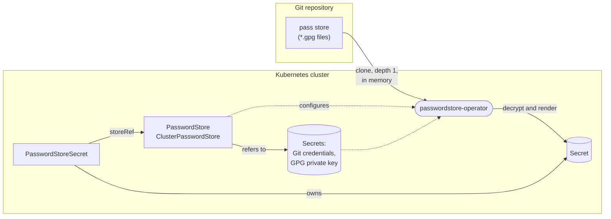

# passwordstore-operator

[](https://github.com/sorend/passwordstore-operator/actions/workflows/ci.yml)
[](https://github.com/sorend/passwordstore-operator/releases)

**Kubernetes Secrets from a [pass](https://www.passwordstore.org/) password store in Git.**

You already keep your secrets in `pass`: GPG-encrypted files in a Git repository. This operator
reads that repository, decrypts the entries with a GPG key that you give it, and keeps ordinary
Kubernetes Secrets up to date. Git stays the source of truth, the cluster holds the key, and a
`PasswordStoreSecret` describes the Secret much like a `SealedSecret` does:

```yaml
apiVersion: passwordstore.k8s.sorend.github.com/v1alpha1
kind: PasswordStoreSecret
metadata:
  name: postgres
spec:
  storeRef:
    name: infra                      # a PasswordStore: the repository and the key
  template:
    type: kubernetes.io/basic-auth
  data:
    password: k8s/postgres.db.svc/admin-user               # the entry k8s/postgres.db.svc/admin-user.gpg
    username: k8s/postgres.db.svc/connection#username      # the line "username: ..." of another entry
```



## Contents

- [Features](#features)
- [Installation](#installation)
- [Quick start](#quick-start)
- [The resources](#the-resources)
- [Git authentication](#git-authentication)
- [GPG keys](#gpg-keys)
- [PasswordStoreSecret](#passwordstoresecret)
- [Status and troubleshooting](#status-and-troubleshooting)
- [Behavior](#behavior)
- [Security](#security)
- [Operations](#operations)
- [Development](#development)
- [Limitations](#limitations)
- [License](#license)

## Features

- **Works with the pass you have.** The standard layout, `.gpg` files that are binary or ASCII-armored,
  single-line and multi-line entries, `username: value` lines, symbolic links inside the store, a
  store in a subdirectory of a repository.
- **Three ways to reach Git.** HTTPS, anonymous or with a token. SSH with a private key and
  *verified* host keys. A GitHub App, which gives the operator short-lived, read-only tokens.
- **Your GPG key, kept in a Secret.** ASCII-armored or binary, with or without a passphrase,
  chosen by fingerprint, key ID or email address. A key without its primary part
  (`gpg --export-secret-subkeys`) works.
- **Namespaced and cluster-wide stores.** A `ClusterPasswordStore` can be limited to the namespaces
  that match a label selector.
- **Careful with your Secrets.** A Secret is never half updated. A Secret that the operator did not
  make is never overwritten. Secrets are removed with the resource that owns them.
- **Observable.** `Ready` conditions with a reason and a message that says what to fix, events,
  `kubectl get` columns, controller-runtime metrics.
- **Small and hardened.** One static Go binary in a distroless image for **amd64 and arm64**. It
  runs as non-root with a read-only filesystem, and holds the repository in memory only. The data of
  Secrets is not cached.
- **Careful with the servers it talks to.** The Git server of a store is chosen by whoever creates
  the store, so what it can make the operator do is limited: how long it can keep it waiting, how much
  memory it can take, and where the operator connects to. See
  [Limits on what a Git server can do](#limits-on-what-a-git-server-can-do).

## Installation

You need a Kubernetes cluster and `kubectl`. The operator is tested on Kubernetes 1.37, with envtest
and with kind. The CRDs use CEL validation rules, which are generally available from Kubernetes 1.29.

Install the CRDs, the permissions and the operator, in the namespace `passwordstore-operator-system`:

```bash
kubectl apply -f https://github.com/sorend/passwordstore-operator/releases/latest/download/install.yaml
kubectl -n passwordstore-operator-system rollout status deployment/passwordstore-operator-controller-manager
```

The image is `ghcr.io/sorend/passwordstore-operator`, tagged with the version (`1.2.3`, `1.2`, `1`
and `latest`), for `linux/amd64` and `linux/arm64`. A release before 1.0 has no tag for its major
version, as its minor versions may break things, and a pre-release such as `1.3.0-rc.1` only has its
own tag. The bundle uses the image of its own release. To pin a version, use
`releases/download/v1.2.3/install.yaml`.

<details>
<summary>Install from source, or uninstall</summary>

From a checkout, with your own image:

```bash
make docker-build docker-push IMG=registry.example.com/passwordstore-operator:dev
make deploy IMG=registry.example.com/passwordstore-operator:dev
```

To remove the operator again, first delete your `PasswordStoreSecret`s if you want their Secrets
gone too, then:

```bash
kubectl delete -f https://github.com/sorend/passwordstore-operator/releases/latest/download/install.yaml
```

This deletes the CRDs, and with them all `PasswordStore`, `ClusterPasswordStore` and
`PasswordStoreSecret` resources. The Secrets that the operator made are deleted with their
`PasswordStoreSecret`.

</details>

## Quick start

This takes about ten minutes. You need `pass`, `gpg`, a private Git repository, and `kubectl` for
your cluster. Everything here happens in the namespace `default`.

### 1. Put the secrets in a pass store, for a key of the cluster

Make a GPG key for the cluster. It is better not to give the cluster your own key: see
[Give the cluster a key of its own](#give-the-cluster-a-key-of-its-own).

```bash
gpg --batch --pinentry-mode loopback --passphrase '' \
    --quick-gen-key 'My Cluster <cluster@example.com>' default default never
```

Let the cluster read one folder of your store, `k8s`. The folder gets a `.gpg-id` of its own, so
its entries are encrypted to your key and to the key of the cluster, and everything else stays
readable by you alone:

```bash
pass init -p k8s you@example.com cluster@example.com
pass insert k8s/postgres.db.svc/admin-user          # one line: the password
pass insert --multiline k8s/postgres.db.svc/connection
#   hunter2
#   username: admin
#   host: postgres.db.svc
pass git push        # your store is in a private Git repository: "pass git remote add origin <url>" if it is not yet
```

### 2. Give the operator access to the repository

The easiest way is a *deploy key*, which can read this one repository and nothing else:

```bash
ssh-keygen -t ed25519 -N '' -C passwordstore-operator -f ./deploy_key
gh repo deploy-key add ./deploy_key.pub --repo you/passwords --title cluster   # read-only by default
```

(or add `deploy_key.pub` as a read-only deploy key in the settings of the repository). Then give the
cluster the private keys, and delete the files:

```bash
kubectl create secret generic git-deploy-key --from-file=ssh-privatekey=./deploy_key

gpg --export-secret-keys --armor cluster@example.com > ./cluster.asc
kubectl create secret generic gpg-key --from-file=private.key=./cluster.asc

shred -u ./deploy_key ./deploy_key.pub ./cluster.asc    # rm -P on macOS
```

### 3. Describe the store and the Secret

Get the host key of your Git server, and compare its fingerprint with what the provider publishes
([GitHub's](https://docs.github.com/en/authentication/keeping-your-account-and-data-secure/githubs-ssh-key-fingerprints)):

```bash
ssh-keyscan -t ed25519 github.com
```

```yaml
# store.yaml
apiVersion: passwordstore.k8s.sorend.github.com/v1alpha1
kind: PasswordStore
metadata:
  name: infra
spec:
  gitRepo:
    url: git@github.com:you/passwords.git
    auth:
      ssh:
        privateKeySecretRef:
          name: git-deploy-key
        knownHosts: |
          github.com ssh-ed25519 AAAAC3NzaC1lZDI1NTE5AAAAIOMqqnkVzrm0SdG6UOoqKLsabgH5C9okWi0dh2l9GKJl
  gpg:
    id: cluster@example.com          # what you gave "pass init"
    privateKeySecretRef:
      name: gpg-key
---
apiVersion: passwordstore.k8s.sorend.github.com/v1alpha1
kind: PasswordStoreSecret
metadata:
  name: postgres
spec:
  storeRef:
    name: infra
  template:
    metadata:
      name: postgres-credentials
    type: kubernetes.io/basic-auth
  data:
    password: k8s/postgres.db.svc/admin-user
    username: k8s/postgres.db.svc/connection#username
```

```bash
kubectl apply -f store.yaml
```

### 4. Look at the result

```console
$ kubectl get passwordstores
NAME    READY   REVISION                                   AGE
infra   True    0adb071a4a25888b349eb5560a8f42936d40c38b   6m12s

$ kubectl get passwordstoresecrets
NAME       STORE   SECRET                 READY   AGE
postgres   infra   postgres-credentials   True    5m55s

$ kubectl get secret postgres-credentials -o jsonpath='{.data.password}' | base64 -d
```

From now on the Secret follows the repository. Change a password with `pass insert -f`, run
`pass git push`, and the Secret is updated within its refresh interval (here the default of five
minutes, or less when the store has noticed the commit first, see [Behavior](#behavior)).

## The resources

The API group is `passwordstore.k8s.sorend.github.com`, version `v1alpha1`.

| Kind | Scope | Short name | What it is |
| --- | --- | --- | --- |
| `PasswordStore` | namespaced | `pws` | A repository and a key. Used by `PasswordStoreSecret`s of its own namespace. |
| `ClusterPasswordStore` | cluster | `cpws` | The same, for every namespace, or the namespaces that a selector allows. |
| `PasswordStoreSecret` | namespaced | `pwss` | The description of one Secret: which store, what it looks like, which entries it is made of. |

`kubectl explain passwordstore.spec --recursive` documents every field. This is the overview.

### PasswordStore and ClusterPasswordStore

Both have the same spec. `ClusterPasswordStore` adds `namespaceSelector`.

| Field | Description |
| --- | --- |
| `gitRepo.url` | `https://`, `http://`, `ssh://[user@]host[:port]/path`, `[user@]host:path` or `[user@]host:/absolute/path`. No credentials in the URL, no `file://`. With `http://`, credentials are sent in the clear. |
| `gitRepo.branch` | The branch to read. Default: the default branch of the repository. A name that starts with `refs/`, such as `refs/tags/v1`, is used as it is. |
| `gitRepo.path` | The directory of the store in the repository, where `.gpg-id` is. Default: the root. |
| `gitRepo.auth` | One of `ssh`, `token` or `app`. Left out for a public repository. See [Git authentication](#git-authentication). |
| `gpg.id` | The key that the store is encrypted to: a fingerprint, key ID or email address. Required. |
| `gpg.privateKeySecretRef` | The Secret key with the private key. Required. |
| `gpg.passphraseSecretRef` | The Secret key with the passphrase of the private key, if it has one. |
| `namespaceSelector` | `ClusterPasswordStore` only. See [Security](#security). |

A reference to a Secret is `name`, `key` and, for a `ClusterPasswordStore`, `namespace`:

- A **PasswordStore** can only use Secrets of its own namespace. `namespace` can be left out.
- A **ClusterPasswordStore** is not in a namespace, so every reference must name one.
- `key` can be left out. These are the defaults:

| Reference | Default key |
| --- | --- |
| `gpg.privateKeySecretRef` | `private.key` |
| `gpg.passphraseSecretRef`, `ssh.passphraseSecretRef` | `passphrase` |
| `ssh.privateKeySecretRef` | `ssh-privatekey` (what a Secret of type `kubernetes.io/ssh-auth` has) |
| `token.tokenSecretRef` | `token` |
| `app.privateKeySecretRef` | `private-key.pem` |

A trailing line break in a token or a passphrase, which `echo` and files leave behind, is removed.

## Git authentication

The URL decides how the operator connects: `https://` and `http://` with a token or without
credentials, `ssh://` and `user@host:path` with an SSH key. A mismatch, for example an SSH key with an
`https://` URL, is refused when you apply the resource.

### Anonymous

For a public repository, leave out `auth`:

```yaml
gitRepo:
  url: https://github.com/you/public-passwords.git
```

(The entries are encrypted, so a public store is possible. Whether it is wise is another question.)

### Token

```yaml
gitRepo:
  url: https://github.com/you/passwords.git
  auth:
    token:
      username: x-access-token       # the default
      tokenSecretRef:
        name: git-token
```

```bash
kubectl create secret generic git-token --from-literal=token=<the token>
```

The token is sent as the password of HTTP basic auth. Most providers accept any user name; some want
a particular one, for example `oauth2` for GitLab OAuth tokens and `x-token-auth` for Bitbucket
repository access tokens. Give the token the least it needs: read access to the repository contents.

### SSH

```yaml
gitRepo:
  url: git@github.com:you/passwords.git       # or ssh://git@host:2222/path
  auth:
    ssh:
      privateKeySecretRef: {name: git-deploy-key}
      passphraseSecretRef: {name: git-deploy-key, key: passphrase}   # if the key has one
      knownHosts: |
        github.com ssh-ed25519 AAAAC3NzaC1lZDI1NTE5AAAAIOMqqnkVzrm0SdG6UOoqKLsabgH5C9okWi0dh2l9GKJl
```

The private key can be in the OpenSSH format or a PEM file, and the user name is the one in the
URL, `git` by default.

**The host key of the server is verified**, unless you turn that off with `insecureIgnoreHostKey`.
`knownHosts` has the same format as a `known_hosts` file, and is required without it. It is part of
the resource and not of a Secret, because host keys are public. Make it with `ssh-keyscan -t ed25519 <host>` (use `-p` for another port) and check
the fingerprint against what the provider publishes. A server whose key does not match is refused,
and the status says so:

```text
the host key of the server does not match knownHosts, the server was replaced or the
connection is intercepted: ssh: handshake failed: knownhosts: key mismatch
```

Only for tests, `insecureIgnoreHostKey: true` accepts any host key, instead of `knownHosts`. This
makes the connection open to interception.

### GitHub App

A GitHub App lets the operator get a token that lasts an hour and can only read contents, without
anybody's personal token in the cluster. The token is for the installation of the App, so for every
repository that the App is installed on: install it on the repository of the store only.

1. Create a GitHub App with the permission *Contents: Read-only*, install it on the repository, and
   generate a private key.
2. Note the **App ID**, and the **installation ID** (the number at the end of the URL of the
   installation's settings page).

```bash
kubectl create secret generic github-app --from-file=private-key.pem=./app-private-key.pem
```

```yaml
gitRepo:
  url: https://github.com/you/passwords.git
  auth:
    app:
      appID: 123456
      installationID: 7890123
      privateKeySecretRef: {name: github-app}
      # baseURL: https://github.example.com/api/v3     # GitHub Enterprise Server
```

The operator signs a short JWT with the key, exchanges it for an installation token, and asks for
`contents: read` whatever else the App may do. The token is kept until five minutes before it
expires. The request with the JWT is never sent on if the API answers with a redirect.

## GPG keys

The operator needs the **private key** that the store is encrypted to, in a Secret:

```bash
gpg --export-secret-keys --armor cluster@example.com > cluster.asc
kubectl create secret generic gpg-key --from-file=private.key=cluster.asc
```

`gpg.id` says which key of the Secret to use, and the same forms work as for `pass init`: the
fingerprint, the long or short key ID (also as `0x…`), or part of the user ID such as the email
address. The Secret can hold several keys, `gpg.id` must select exactly one. If it selects none, the
status lists the keys that the Secret has.

**A passphrase** is given in another Secret key:

```yaml
gpg:
  id: cluster@example.com
  privateKeySecretRef: {name: gpg-key}
  passphraseSecretRef: {name: gpg-key, key: passphrase}
```

A passphrase protects a key that has leaked from its Secret less than it seems, because the passphrase
is in the cluster too. Its use is a key that is not stored in plain text in backups and chat.

### Give the cluster a key of its own

Use a key made for the cluster, not your own. Encrypt to both, and give the cluster only the part of
the store that it needs. `pass init -p` gives a folder its own `.gpg-id`:

```bash
pass init -p k8s you@example.com cluster@example.com
```

Entries in `k8s/` are now encrypted to your key and to the key of the cluster (existing ones are
encrypted again), and the key of the cluster cannot decrypt the rest of the store. This is checked
against the real `pass` in the tests of this repository. The paths in `data` then start with `k8s/`.

If you want the primary key out of the cluster, export only the subkeys:
`gpg --export-secret-subkeys --armor cluster@example.com`. The operator can decrypt with them.

### What the operator does and does not do

- It decrypts messages that are binary or ASCII-armored, compressed or not, to one or several keys,
  also with hidden recipients (`--throw-keyids`).
- It requires the integrity protection that GnuPG always adds, and refuses entries that were changed.
- It refuses entries that are encrypted to more than 32 keys. Every copy of the session key that is
  for this key, or for no key in particular, has to be tried, and that costs a private key operation,
  so a file with thousands of them could be used to keep the operator busy.
- It does **not verify signatures**, see [Security](#security).
- A key that has expired still decrypts, as with GnuPG.
- Entries are limited to 1 MiB, which is also the limit of a Secret.

## PasswordStoreSecret

| Field | Description |
| --- | --- |
| `storeRef.kind` | `PasswordStore` (default) or `ClusterPasswordStore`. |
| `storeRef.name` | The name of the store. A `PasswordStore` is looked up in the namespace of the `PasswordStoreSecret`. |
| `refreshInterval` | How often the store is checked for changes and the Secret is rendered again. Default `5m`, at least `10s`. |
| `template.metadata.name` | The name of the Secret. Default: the name of the `PasswordStoreSecret`. |
| `template.metadata.labels`, `.annotations` | Added to the Secret. |
| `template.type` | The type of the Secret, for example `kubernetes.io/tls`. Default `Opaque`. `kubernetes.io/service-account-token` is refused, see [Security](#security). |
| `data` | The keys of the Secret, and for each one the entry that it is made of. |

The Secret is always made in the namespace of the `PasswordStoreSecret`, and is **owned** by it: it
is deleted with the `PasswordStoreSecret`.

### The values of `data`

Each value is the path of an entry, relative to the root of the store and without `.gpg`:

| Value | What the key gets |
| --- | --- |
| `k8s/db/admin` | The whole entry. If it is one line, without its line break. An entry with several lines is used exactly as it is stored. |
| `k8s/db/admin#1` | Line 1 of the entry. In pass, this is the password. |
| `k8s/db/admin#2` | Line 2, and so on. |
| `k8s/db/admin#username` | The value of the first line `username: …` after the first one. The key is matched without regard to case, the value is trimmed. The name of a field has no colon in it. |
| `k8s/db/admin.gpg` | The same as without `.gpg`, the name of the file is accepted too. |

Why this way: a password has no line break at the end, but `pass` always writes one. A certificate
or an SSH key does need its final line break, so entries with several lines are not touched. The
entries that follow the convention of pass (the password first, then `key: value` lines) are
read with `#1` and `#field`.

A path does not contain `.`, `..`, empty parts or `\`. A leading `/` is ignored. Symbolic links in the
store are followed, but never out of the store. If a `#` is followed by a `/` it is part of the
path, and otherwise a `#` starts a selector: an entry whose own name has a `#` in it cannot be
addressed.

### Examples

A **TLS** certificate, stored with `pass insert -m k8s/tls/example.crt < tls.crt` and the same for the key:

```yaml
spec:
  storeRef: {name: infra}
  template: {type: kubernetes.io/tls}
  data:
    tls.crt: k8s/tls/example.crt
    tls.key: k8s/tls/example.key
```

A **registry credential**, with the JSON of a Docker config as the entry:

```yaml
spec:
  storeRef: {name: infra}
  template: {type: kubernetes.io/dockerconfigjson}
  data:
    .dockerconfigjson: registry/ghcr.io
```

**Several settings** in one Secret, for `envFrom`:

```yaml
spec:
  storeRef: {name: infra}
  refreshInterval: 1m
  data:
    DATABASE_PASSWORD: k8s/postgres.db.svc/admin-user
    DATABASE_USER: k8s/postgres.db.svc/connection#username
    API_TOKEN: k8s/api/token
```

### Metadata

The Secret gets the label `app.kubernetes.io/managed-by: passwordstore-operator`, which a template
cannot change. A label or an annotation that you take out of the template is also taken off the
Secret: the annotation `passwordstore.k8s.sorend.github.com/managed-metadata` lists which ones came from
the template, and it is how the operator knows. Labels and annotations that something else put on
the Secret are left alone.

## Status and troubleshooting

Every resource has a `Ready` condition with a reason, and `observedGeneration`. A store reports the
`revision` (commit) that it fetched, a `PasswordStoreSecret` the revision that its Secret was made from.
Events show the same. `kubectl get -o wide` shows the message.

```console
$ kubectl describe passwordstoresecret postgres
...
Status:
  Conditions:
    Message:               Secret postgres-credentials rendered from revision 0adb071
    Reason:                Synced
    Status:                True
    Type:                  Ready
  Last Refresh Time:       2026-11-24T19:35:47Z
  Revision:                0adb071a4a25888b349eb5560a8f42936d40c38b
  Secret Name:             postgres-credentials
Events:
  Type     Reason         Message
  ----     ------         -------
  Warning  EntryNotFound  data["username"]: entry "k8s/postgres.db.svc/connection" not found in the store (looked for k8s/postgres.db.svc/connection.gpg)
  Normal   Synced         Secret postgres-credentials is up to date
```

### Reasons

| Reason | Meaning |
| --- | --- |
| `Synced` | All is well. |
| `InvalidSpec` | The spec does not make sense, or asks for what the operator is set not to accept. Examples: a `PasswordStore` that refers to a Secret in another namespace, a `ClusterPasswordStore` that refers to a Secret without a namespace, an entry path with `..`, an unknown store kind, a host that is not in `--allowed-git-hosts`, a Secret of the type `kubernetes.io/service-account-token`. All problems of `data` are listed at once. |
| `CredentialsUnavailable` | A Secret or a key that the store refers to does not exist, is empty, or may not be read. If the Secret exists, the message lists its keys. It is tried again every retry interval. |
| `GitSyncFailed` | The repository could not be fetched: network, authentication, a branch or `path` that does not exist, a host key that does not match, a server that does not answer in time, an address that the operator does not connect to, a repository that is larger than the [limits](#limits-on-what-a-git-server-can-do). The message has the error, shortened. |
| `GPGKeyInvalid` | The key cannot be used: the Secret has no private key (only the public one was exported), `gpg.id` matches no key (the message lists the ones it has) or more than one, the passphrase is missing or wrong. |
| `StoreNotFound` | The store of a `PasswordStoreSecret` does not exist. It is used as soon as it is made. |
| `NamespaceNotAllowed` | The `namespaceSelector` of the `ClusterPasswordStore` does not match the namespace. |
| `EntryNotFound` | An entry is not in the store or cannot be read, or the line or field after `#` does not exist. Every such entry is listed. |
| `DecryptFailed` | An entry is not encrypted to the key (the usual cause: the key was added after the entry was made, run `pass init` again), is not an OpenPGP message, is encrypted to more than 32 keys, or is too large. |
| `SecretConflict` | The Secret exists and was not made by this `PasswordStoreSecret`. See [Behavior](#behavior). |
| `SecretApplyFailed` | The Secret cannot be written: its type would have to change, or the API server refuses it, for example a `kubernetes.io/tls` Secret without `tls.crt`. |
| `PermissionDenied` | The operator is not allowed to do what it needs to, for example to read the namespace of a `PasswordStoreSecret` that uses a `ClusterPasswordStore` with a `namespaceSelector`. Nothing is allowed then. |

### Common problems

| You see | Because |
| --- | --- |
| `authentication required` | Over HTTP(S): the token has no access to the repository. GitHub says "Repository not found" when it means "no access". |
| `ssh: unable to authenticate` | Over SSH: the server does not accept the key. Is it added to the repository, as a deploy key or to the account? |
| `address not allowed` | The server is at a loopback or link-local address, which the operator never connects to. |
| `host not allowed` | The host is not in `--allowed-git-hosts`. |
| `limit exceeded` | The repository, or what the server sends, is larger than the [limits](#limits-on-what-a-git-server-can-do). Make the repository smaller, or raise the limits and the memory. |
| `i/o timeout`, `context deadline exceeded` | The Git server does not answer within `--git-timeout`. |
| `the server is not in knownHosts` | `knownHosts` has no line for that host and port. For a port other than 22, the line is `[host]:2222 ssh-ed25519 …`, which is what `ssh-keyscan -p 2222` makes. |
| `has no key "private.key"` | The Secret has other keys. Rename the key, or set `key` in the reference. |
| `key material contains no private key` | You exported with `gpg --export`. Use `--export-secret-keys`. |
| `x509: certificate signed by unknown authority` | The Git server uses a private certificate authority. See [Operations](#operations). |
| The Secret does not change after a push | It changes within `refreshInterval` plus `--git-cooldown` at the latest. Check `status.revision` and `lastRefreshTime`, and the `Ready` condition. |
| The operator is killed (OOM) | The repositories of the stores are held in memory. See [sizing](#metrics-logs-and-sizing). |
| I renamed the Secret and the old one is still there | The operator never deletes a Secret. See [Behavior](#behavior). |

## Behavior

**When a Secret is refreshed.** A `PasswordStoreSecret` checks its store every `refreshInterval`, and
again whenever its store reports a new revision. A store checks its repository when it is made or
changed, and every five minutes (`--store-sync-interval`). Checking is cheap: the operator asks the
server for the commit of the branch, and only downloads the repository, one commit deep, into
memory when it is not the one it has. Repositories are shared between the `PasswordStoreSecret`s of a store: a
check that has been done in the last 10 seconds (`--git-cooldown`), including a failed one, is used
again, so many Secrets do not make many requests. A server that does not answer is given up on
after `--git-timeout`, and a fetch that fails is not tried again by the others within the cooldown,
so one broken server does not hold up the rest for long. A new commit shows up in the Secrets
within the refresh interval plus the cooldown. In a test on a k3s cluster, with a refresh interval of ten
seconds, a change that was pushed showed up in the Secret within ten seconds. A branch or a tag is
checked in the same way: a tag is named in full, `refs/tags/v1`, and is not downloaded again for as long
as it points to the same commit.

A `PasswordStoreSecret` that fails is tried again after `--retry-interval`, or after its refresh
interval when that is shorter.

**Never half updated.** All entries are read and decrypted first. If any of them fails, nothing is
written, the problems are listed in the status, and the Secret keeps the content that it had.
The Secret is also not written when nothing changed.

**What it will not overwrite.** If a Secret with the name exists that this `PasswordStoreSecret` did not
make, the status is `SecretConflict` and the Secret is not touched. To let the operator take over a
Secret, annotate the Secret with `passwordstore.k8s.sorend.github.com/managed: "true"`. A Secret that
another controller owns is never taken over.

**The Secret is made right again** when it is changed or deleted by somebody else: the data of the
Secret is exactly the keys of `spec.data`.

**The type of a Secret cannot change** in Kubernetes. If you change `template.type`, the status says
so, and the Secret is made again with the new type when you delete it.

**Deleting** a `PasswordStoreSecret` deletes the Secret, through its owner reference. The operator
itself never deletes a Secret, it has no permission to. Failures never delete one. That includes a store
that disappears, and a namespace that a `ClusterPasswordStore` stops allowing: the `PasswordStoreSecret`
reports `NamespaceNotAllowed`, but the Secret that was made while it was allowed stays until you delete
the `PasswordStoreSecret`.

**Renaming the Secret** with `template.metadata.name` makes a new Secret, and leaves the old one where
it is. It is still owned by the `PasswordStoreSecret`, so it goes with it, but until then it keeps what
it had, which is no longer updated. Delete it yourself if it should not be there.

**Restarts** do not change Secrets. The operator can be moved, restarted and upgraded freely: a
reconcile that finds the Secret as it should be does not write.

## Security

**Who can read what.** The key of a store can decrypt everything that is encrypted to it. For
a `PasswordStore`, anybody who can create `PasswordStoreSecret`s in its namespace can read every entry
the key opens. That is more than the Secrets of the namespace, if somebody is allowed to create
`PasswordStoreSecret`s and not to read Secrets. For a **`ClusterPasswordStore`**, anybody who can create a
`PasswordStoreSecret` in *any* namespace can, unless you limit it:

```yaml
kind: ClusterPasswordStore
spec:
  ...
  namespaceSelector:
    matchLabels:
      team: platform
```

Only namespaces with that label may use the store. **Without a selector all namespaces may**, which is
why you should give a `ClusterPasswordStore` one. Who may label a namespace is who may grant access. Use the [folder with a key of its own](#give-the-cluster-a-key-of-its-own),
and one store per team when teams must not see each other's entries.

**Git decides what the Secrets contain.** Encryption keeps the entries secret, it does not say who
wrote them: the *public* key that anybody could have encrypted to is all that is needed to make an
entry. Whoever can push to the repository can change what ends up in your Secrets. Protect the branch,
require review, and give the operator read access only (a deploy key is read-only by default).
The operator does not verify the signatures of commits or entries.

**Who can create stores.** A `PasswordStore` names a Git server, and the Secrets with the credentials for
it, in its own namespace. Whoever can create one can name *any* Secret of the namespace as the token,
and a Git server of their own, and the operator sends the value of that key to that server as the password
of the request. So the right to create a `PasswordStore` is also the right to read the keys of the Secrets
of the namespace, and one to make the operator connect to servers. Give it to the people who can read
those Secrets anyway. `--allowed-git-hosts` limits where the credentials can go to, and a network policy
does the same for everything else.

**Secrets and memory.** The operator reads the Secrets it needs by name, directly from the API server.
It does not cache the data of the Secrets of the cluster, and only watches the *metadata* of Secrets to notice
that one of its own was edited. Repositories and decrypted entries are only held in memory, and
nothing is written to disk but the (public) host keys, for a moment. Values of Secrets are not
written to logs, events or status, and the credentials that the operator used are removed from
error messages. The pod runs as non-root with a read-only root filesystem, no capabilities, and the
`RuntimeDefault` seccomp profile, which meets the `restricted` Pod Security Standard.

**Where it connects.** Only to the repository URL (`https`, `http`, `ssh`) and, for a GitHub App,
to its API. `file://` URLs, which would read the filesystem of the operator, and credentials in a URL, are
refused. Loopback and link-local addresses are never connected to, whatever the name resolves to: that
is where the metadata service of a cloud is, with credentials for the node. Other addresses are, the
addresses of the cluster and of your network included, as that is where a Git server of your own is. So
whoever can create a store can make the operator send a request to a Service in the cluster, and the
beginning of an error answer ends up in the status of the store, shortened and with what a terminal acts
on removed. Limit who can create stores, name the hosts that are allowed with `--allowed-git-hosts`, and use a
network policy for what leaves the pod. A proxy from the environment (`HTTPS_PROXY`, `ALL_PROXY`) is used,
and it is the address of the proxy that is checked.

**The templates of Secrets.** A `PasswordStoreSecret` makes a Secret, with the type, labels and
annotations of its template, for people who may not have the right to create Secrets. A Secret of the
type `kubernetes.io/service-account-token` is refused for that reason: Kubernetes fills it with the
token of the ServiceAccount that an annotation names. Annotations and labels are copied as they
are, so a controller that acts on those of Secrets, to copy a Secret to other namespaces for example,
acts on them. Do not give the right to create `PasswordStoreSecret`s to people who may not use that.

**The permissions of the operator**, as `kubectl apply` installs them:

| Resource | Verbs | Why |
| --- | --- | --- |
| `secrets` | get, list, watch, create, update | Read credentials, write generated Secrets, notice changes to them. There is **no delete**: Secrets go with their owner. |
| `namespaces` | get, list, watch | For `namespaceSelector`. |
| `passwordstores`, `clusterpasswordstores`, `passwordstoresecrets` | get, list, watch | Read what you define. It never changes your resources, only their status. |
| the same, `/status` | get, update, patch | Report. |
| `passwordstoresecrets/finalizers` | update | To make the Secrets that it generates owned by the resource, in a way that a cluster with the `OwnerReferencesPermissionEnforcement` plugin accepts. |
| `events` (`events.k8s.io`) | create, patch | Events. |
| `leases` and `events`, in its own namespace | get, create, update and create, patch | Leader election. |
| `tokenreviews`, `subjectaccessreviews` | create | To protect the metrics endpoint with the authentication and authorization of Kubernetes. |

Kubernetes cannot separate the data from the metadata of a Secret in a permission, so the operator can
read every Secret of the cluster. It does not, but a cluster that cannot accept this should not run
it: it cannot be limited to some namespaces yet.

On a cluster with the `OwnerReferencesPermissionEnforcement` admission plugin, which OpenShift has,
changing the owner of an existing object needs the permission to delete it. The operator has none, so it
cannot take over a Secret with the annotation `passwordstore.k8s.sorend.github.com/managed` there. Delete
the Secret and let the operator make it, or give the operator the right to delete Secrets.

## Operations

### Flags

| Flag | Default | |
| --- | --- | --- |
| `--git-timeout` | `30s` | How long a fetch from a repository may take, including the exchange of a GitHub App token and the time that a connection may last. |
| `--git-max-repository-size` | `64Mi` | How much a repository may take in memory once it is decompressed. A larger one is refused. |
| `--git-cache-size` | `128Mi` | How much all the repositories that are kept may take together. The ones that were used least are dropped to make room. |
| `--allowed-git-hosts` | none | Comma-separated hosts that the operator may connect to, such as `github.com,*.example.com`. `*.` stands for what is below a domain. Empty: any host. |
| `--git-cooldown` | `10s` | A check of a repository that is this recent is reused by the Secrets of the store. `0` contacts the server on every refresh. |
| `--store-sync-interval` | `5m` | How often a store checks its repository on its own. |
| `--retry-interval` | `1m` | How soon something that failed is tried again. A `PasswordStoreSecret` with a shorter refresh interval uses that. |
| `--reconcile-timeout` | `3m` | How long one reconcile may take. It must be longer than `--git-timeout`. |
| `--max-concurrent-reconciles` | `4` | Per controller. |
| `--leader-elect` | on in the Deployment | One operator is active, the others wait. |
| `--metrics-bind-address` | `:8443` in the Deployment | Metrics over HTTPS, protected by Kubernetes authentication and authorization. |
| `--health-probe-bind-address` | `:8081` | `/healthz` and `/readyz`. |
| `--zap-devel` and the other `--zap-*` flags | | Logs are JSON at info level. `--zap-devel` gives a console format and debug level. |

### Metrics, logs and sizing

The metrics are those of controller-runtime (`controller_runtime_reconcile_total`,
`workqueue_*`, `rest_client_*` …) on `:8443`. `config/prometheus` has a `ServiceMonitor` for the
Prometheus Operator, which is not part of the default bundle.

The operator is small: in a test on a Raspberry Pi (arm64) with four stores and as many Secrets it used
37 millicores and 19 MiB. Each store is held in memory once, one commit deep, and what it takes is
limited, see below. A store of a few thousand entries takes a few megabytes.

The memory limit in the bundle is 512 MiB, and `GOMEMLIMIT` is 400 MiB, which makes the garbage collector
work harder before the limit is reached instead of the pod being killed at it. A download takes a few times
the size of the repository while it is made, and two are made at a time, so the memory limit should be
more than `--git-cache-size` plus four times `--git-max-repository-size`. If you raise those, raise the
memory limit, and `GOMEMLIMIT` with it.

### Limits on what a Git server can do

The Git server of a store is chosen by whoever creates the store, so it can be one that does not
answer, that sends and sends, or that sends a few kilobytes that become gigabytes. These are the
limits, all of them checked in tests against such servers:

| What | Limit |
| --- | --- |
| Time of a fetch, also for a server that says nothing after the connection is made, or that sends its first line very slowly | `--git-timeout` (30s). It is a limit on the connection itself, which the library does not have for SSH. |
| Size of a repository, decompressed | `--git-max-repository-size` (64Mi). It is checked from what the packfile says about its objects, before anything is decompressed. |
| One object, and the result of a delta | 16Mi, or less when the repository may not be that large. |
| Number of objects | 100,000. |
| What a server sends in a download | The size of a repository plus 1 MiB. |
| The list of the branches of a repository | 8 MiB. |
| The body of an error answer | 64 KiB. What is shown of it in the status is shortened to 1,024 characters, and has no control characters. |
| Repositories that are kept | `--git-cache-size` (128Mi), the ones that were used least are dropped. A store that nobody asked for in an hour is forgotten. |
| Downloads at the same time | 2. A server that does not answer is found out before a download slot is taken, so such servers do not keep the slots. |
| Where it connects | Never loopback or link-local addresses (this includes `169.254.169.254`). Only `--allowed-git-hosts` when it is set. |
| Entry in the store | 2 MiB encrypted, 1 MiB decrypted, at most 32 recipients. |
| Redirects | Credentials are not sent to another place than they were meant for, and the JWT of a GitHub App is not sent at all if the API answers with a redirect. |

A fetch that fails is remembered for `--git-cooldown`, so a server that is broken is not asked by every
`PasswordStoreSecret` of its store.

### A Git server with a private certificate authority

The operator trusts the system certificates of its image, and the certificates in `SSL_CERT_DIR` in
addition (not `SSL_CERT_FILE`, which *replaces* them). Put the CA in a ConfigMap, mount it, and set the
variable:

```bash
kubectl -n passwordstore-operator-system create configmap private-ca --from-file=ca.crt=./ca.pem
kubectl -n passwordstore-operator-system patch deployment passwordstore-operator-controller-manager --type=json -p='[
  {"op":"add","path":"/spec/template/spec/volumes/-","value":{"name":"private-ca","configMap":{"name":"private-ca"}}},
  {"op":"add","path":"/spec/template/spec/containers/0/volumeMounts/-","value":{"name":"private-ca","mountPath":"/etc/ssl/private-ca"}},
  {"op":"add","path":"/spec/template/spec/containers/0/env","value":[{"name":"SSL_CERT_DIR","value":"/etc/ssl/private-ca"}]}]'
```

### Upgrading

The API is `v1alpha1`: it can still change between releases, and the release notes say how. Apply the
`install.yaml` of the new release, which updates the CRDs and the operator together. Secrets are
not touched by an upgrade.

## Development

You need Go (the version in `go.mod`), Docker, [kind](https://kind.sigs.k8s.io/) for the end-to-end tests,
and `git` and `gpg`. `pass` is optional: the tests that use the real thing are skipped without it.

```text
api/v1alpha1/        the CRD types, with the validation rules as markers
cmd/                 main: flags and wiring
internal/controller  the reconcilers
internal/gitstore    fetching a store from Git: auth, in-memory clone, limits, snapshots, symbolic links
internal/gpg         decrypting entries with go-crypto
internal/entry       the syntax of the values of data
internal/printable   making what a server says fit to be shown in a status, an event or a log
internal/testutil    test helpers: Git servers over HTTP(S) and SSH, a fake GitHub API, PGP keys
test/e2e             end-to-end tests on a kind cluster
config/              kustomize: CRDs, RBAC, the Deployment, samples
```

```bash
make test        # unit tests, controller tests against a real API server (envtest), with -race
make lint        # golangci-lint, with the Kubernetes logging conventions
make test-e2e    # builds the image and runs it in a new kind cluster. Only against kind: see below.
make manifests generate   # after a change to the types or the RBAC markers
```

What the tests do:

- **Unit tests** for the syntax of entries, decryption, and the Git layer. The Git layer is tested over
  *real* transports: `git http-backend` over HTTP and HTTPS, and an SSH server in the test, with
  anonymous access, tokens, SSH keys with host key checking, and symbolic links that try to leave
  the store. The GitHub App flow is tested against an emulation of the GitHub API, not against GitHub.
- **Tests with servers that misbehave**: ones that never answer, that send for ever, that send a
  packfile that is hand made to claim gigabytes, that redirect, and ones at addresses that must not be
  connected to. The tests of the limits were checked by taking each limit out and seeing the test fail.
- **Interoperability tests** that run the real `gpg` and `pass` (keys of several kinds, with and
  without passphrases, subkeys only, the folder pattern above) and check that the operator reads what they
  make.
- **Controller tests** (over a hundred scenarios) run the controllers in a manager against a real
  kube-apiserver and etcd (envtest): the whole life of the resources, the watches, the schema of the CRDs.
  They have no garbage collection and no real RBAC. The examples in this README and in `config/samples`
  are also checked there: every complete resource, and every fragment that is a `gitRepo`, a `gpg` or the
  `spec` of a `PasswordStoreSecret`, is sent to the API server as a dry run, so an example that the schema
  refuses fails the tests.
- **End-to-end tests** deploy the *image*, with the real permissions and the restricted Pod Security
  Standard, to a kind cluster, and run the same scenarios through `kubectl`, including garbage collection.
  **Run them only against a cluster that kind made for them**: they create and delete namespaces and
  cluster roles. `make test-e2e` makes its own cluster. Set `KUBECONFIG` to a file of its own if you do
  not want kind to change your kubeconfig.

`make lint` needs a golangci-lint that can read the export data of the Go toolchain: with a toolchain
newer than the one of `go.mod`, run it with that one, for example `GOTOOLCHAIN=go1.26.11 make lint`.

Gotcha when writing markers in the types: `gofmt` turns `''` in a comment into a typographic quote,
which breaks a CEL expression. Use `size(x) > 0` and not `x != ''`.

### Releasing

Push a tag that starts with `v`:

```bash
git tag v0.1.0 && git push origin v0.1.0
```

The workflow in `.github/workflows/ci.yml` lints, tests and runs the end-to-end tests for that
commit. If they pass, it builds the image for `linux/amd64` and `linux/arm64`, pushes it to
`ghcr.io/<owner>/<repo>` (tagged `0.1.0`, `0.1`, `latest`, and from 1.0 also `1`; pre-releases such as
`v0.2.0-rc.1` only get their own tag), checks that both architectures are in the pushed image, and creates a
GitHub release with `install.yaml` for that image. Pull requests and pushes to `main` run the same checks
and build the image without pushing it.

GitHub creates the package of the image as private. After the first release, open the package (it is
listed under Packages on the page of the repository), go to its settings, and under Danger Zone change
the visibility to Public. A cluster pulls the image without credentials, so until you do, the pods of
`install.yaml` stay in `ImagePullBackOff`. A public package cannot be made private again.

Whoever can push a tag that starts with `v` publishes a release, so protect those tags in the settings
of the repository (a tag ruleset), and let only the people who release create them.

## Limitations

- The API is `v1alpha1`.
- **Entries are used as they are.** There is no template language (as in External Secrets) for
  combining entries, only the selectors `#N` and `#field`.
- **Signatures are not verified**: not those of commits, nor those of entries, nor the `.gpg-id.sig` of pass.
- **`.gpg-id` is not read.** `gpg.id` selects the key, and an entry that the key cannot decrypt is an error.
- One branch (or `refs/…` name) per store, and no pinning to a commit. A tag is named in full:
  `refs/tags/v1`.
- The operator never deletes Secrets: a Secret that is left over from a rename of `template.metadata.name`
  is for you to delete.
- An entry whose own name has a `#` in it cannot be addressed, and a field name cannot have a colon.
- A `PasswordStoreSecret` has at most 100 keys, and a Secret and an entry are at most 1 MiB.
- No setting for a certificate authority (use `SSL_CERT_DIR`), a proxy other than the usual
  environment variables, or Git submodules.
- It runs cluster-wide, not limited to some namespaces.
- A change of a credential Secret is noticed at the next check of a store or a Secret, not at once.

## License

The operator is released under the [MIT License](LICENSE). The container image has a copy of the
license in `/licenses/LICENSE`. The libraries that the operator uses have licenses of their own.
